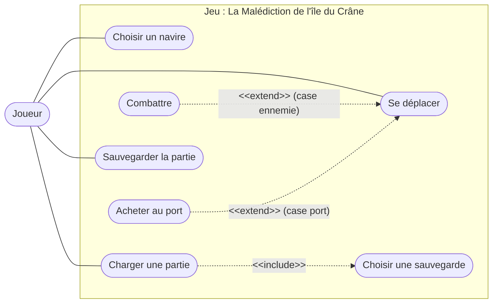
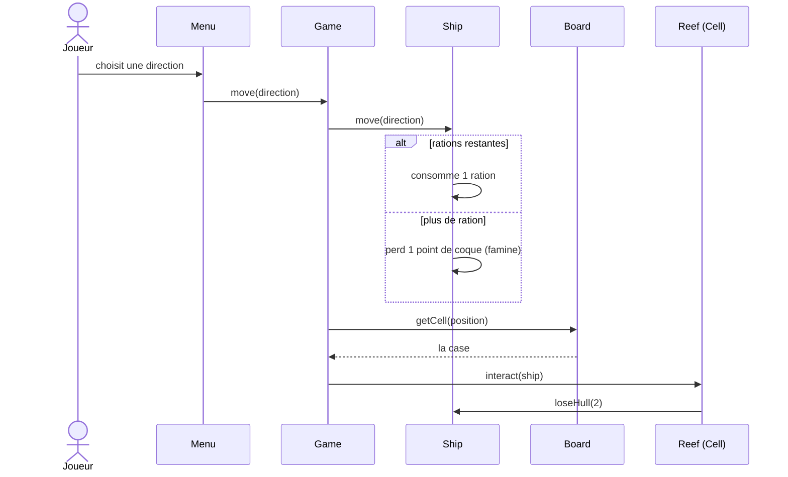
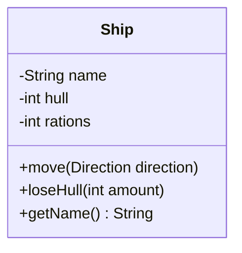
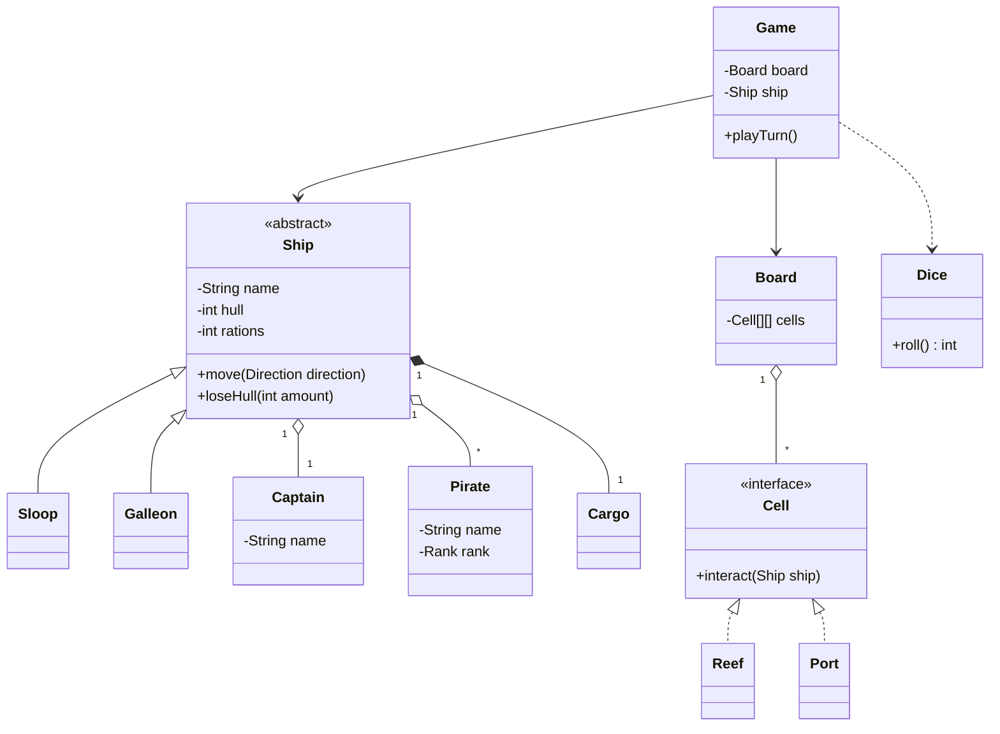

# Annexe : concevoir avant de coder avec UML

Dans la pratique, on ne commence jamais un projet en codant directement. On écrit d'abord ce que le logiciel doit faire (les **spécifications** : besoins et fonctionnalités, comme les « règles du jeu » du kit), on choisit l'architecture technique (ici : du Java, la console, IntelliJ), puis on complète avec un **dossier technique** fait de schémas. **UML** (*Unified Modeling Language*) est le langage de schémas le plus répandu pour décrire un programme.

Cette annexe présente trois diagrammes, du plus général au plus proche du code :

| Diagramme | Question à laquelle il répond |
| --- | --- |
| **Cas d'utilisation** (*use case*) | Qui utilise le logiciel, et pour faire quoi ? |
| **Séquence** | Dans quel ordre les objets s'envoient-ils des messages pour réaliser une action ? |
| **Classes** | Quelles classes existent, que contiennent-elles, comment sont-elles reliées ? |

> UML décrit le **programme**. Le **MCD / MLD** (chapitre sur les bases de données) décrit la **base de données**. Les deux se ressemblent (des boîtes et des traits) mais ne se mélangent pas : une classe `Ship` n'est pas une table `ship`.

## Objectifs

À la fin de l'annexe, tu sauras :

* lire et dessiner un diagramme de **cas d'utilisation**, de **séquence** et de **classes** ;
* distinguer **héritage**, **réalisation** (interface), **association**, **agrégation**, **composition** et **dépendance** ;
* écrire un diagramme avec **Mermaid** (du texte transformé en schéma) ou le générer depuis ton code avec IntelliJ ;
* choisir le bon niveau de détail.

## Des normes, mais pas de dogme

Les diagrammes ont des **normes** et des **conventions** pour que tout le monde puisse les lire. Dans la pratique, chaque équipe les adapte à ses habitudes : tu trouveras des variantes selon les sites. Ce qui compte, c'est qu'un lecteur comprenne ton schéma sans explication orale.

## Les outils

* **[draw.io](https://www.drawio.com/)** : un éditeur de schémas en ligne, gratuit, pour tous les diagrammes à la souris.
* **[sequencediagram.org](https://sequencediagram.org/)** : un éditeur dédié aux diagrammes de séquence.
* **Mermaid** : on écrit le diagramme sous forme de **texte**, et un outil l'affiche. C'est pratique pour le garder dans un fichier `.md`, versionné avec le code. Les exemples de cette annexe sont écrits en Mermaid. GitHub et de nombreux éditeurs Markdown l'affichent ; sinon, l'éditeur en ligne du projet Mermaid permet de coller le texte et de voir le résultat.
* **IntelliJ** : il sait **générer** un diagramme de classes à partir de ton code (voir plus bas).

## Le diagramme de cas d'utilisation

C'est le plus simple à réaliser. Il définit les **interactions des utilisateurs avec le logiciel**, sans parler de code.

Éléments :

* un **acteur** (un bonhomme) : un type d'utilisateur. On sépare souvent les rôles qui ont des droits différents (utilisateur, responsable, administrateur...) ;
* le **système** : un grand rectangle qui contient les cas d'utilisation ;
* un **cas d'utilisation** (une bulle) : une action que l'acteur peut faire ;
* un **trait** entre l'acteur et la bulle : l'acteur déclenche cette action.

Entre deux bulles, deux liens existent :

* **`<<include>>`** : l'action A **utilise toujours** l'action B. Par exemple, avant de charger une partie, il faut choisir une sauvegarde ;
* **`<<extend>>`** : l'action B **s'ajoute parfois** à l'action A, sous condition. Par exemple, quand le navire arrive sur une case ennemie, un combat s'engage en plus du déplacement.

Voici le jeu du kit. Il n'y a qu'un acteur : le joueur.

Mermaid ne possède pas de diagramme de cas d'utilisation à proprement parler : le schéma ci-dessus est un schéma de flux **qui imite** la notation (un rond pour l'acteur, des ovales pour les cas, des flèches pointillées pour `extend` et `include`). Pour un schéma conforme avec le bonhomme et le rectangle, utilise draw.io.

> **Sens des flèches.** Pour `extend`, la flèche part de l'action **ajoutée** (`Combattre`) vers l'action **de base** (`Se déplacer`). Pour `include`, elle part de l'action de base (`Charger une partie`) vers l'action **incluse** (`Choisir une sauvegarde`).

Chaque bulle est une fonctionnalité, donc un morceau du programme à écrire : le diagramme sert de **liste de choses à faire** et vérifie qu'aucune règle du jeu n'est oubliée.

## Le diagramme de séquence

Il approfondit un cas d'utilisation : on peut imaginer **un diagramme de séquence par bulle**. Il décrit les échanges entre objets **dans l'ordre**.

Éléments :

* en haut, la liste des **participants** (acteur ou objets) ;
* sous chacun, une **ligne de vie** verticale (elle commence à la création de l'objet et s'arrête quand il disparaît) ;
* des **flèches horizontales** : chaque flèche est un **message**, c'est-à-dire en pratique un **appel de méthode**, avec ses paramètres ;
* le **temps** s'écoule de haut en bas ;
* une flèche pointillée de retour montre une valeur renvoyée (facultatif, à utiliser seulement si c'est utile) ;
* des blocs **`alt`** (alternative : si / sinon), **`opt`** (facultatif) et **`loop`** (répétition) encadrent les parties conditionnelles.

Voici le cas « Se déplacer » quand la nouvelle case est un récif.

On y lit directement le plan du code : `Menu` ne connaît pas `Ship` (il passe par `Game`), c'est `Cell` qui sait quel effet produire (polymorphisme du chapitre 11), et aucune méthode ne fait tout toute seule. Les noms de méthodes (`getCell`, `loseHull`) sont des **choix de conception** : tu peux en choisir d'autres, du moment que le schéma et le code restent d'accord.

> Un diagramme de séquence sert à **réfléchir avant de coder** et à **expliquer** : pas besoin d'en faire pour toutes les actions. Garde-le pour celles où plusieurs objets collaborent.

## Le diagramme de classes

Il **documente ton code** et montre les dépendances entre les classes. On le prépare normalement **avant**, puis on le complète au fil du développement. Si tu as déjà commencé, tu peux le **générer depuis ton code** (*reverse engineering*, voir plus bas).

### Lire une classe

Une classe est un rectangle à trois compartiments : le **nom**, les **attributs**, les **méthodes**.

* `-` privé, `+` public, `#` protégé, `~` visibilité package ;
* en Mermaid, on écrit le type **avant** le nom d'un attribut (`-int hull`) et le type de retour **après** la méthode (`getName() String`) ;
* une classe **abstraite** ou une **interface** est signalée par `<<abstract>>` ou `<<interface>>` dans le rectangle.

### Les liens entre classes

| Lien | Mermaid | Se lit | En Java |
| --- | --- | --- | --- |
| **Héritage** | `Ship <\|-- Sloop` | `Sloop` est un `Ship` | `class Sloop extends Ship` |
| **Réalisation** | `Cell <\|.. Reef` | `Reef` réalise le contrat `Cell` | `class Reef implements Cell` |
| **Association** | `Game --> Board` | `Game` connaît `Board` | un attribut de type `Board` |
| **Agrégation** | `Ship o-- Captain` | `Ship` a un `Captain`, qui existe sans lui | un attribut reçu de l'extérieur |
| **Composition** | `Ship *-- Cargo` | `Ship` possède sa `Cargo`, qui disparaît avec lui | un attribut créé par la classe |
| **Dépendance** | `Game ..> Dice` | `Game` utilise `Dice` ponctuellement | un paramètre ou une variable locale |

* La pointe de la flèche d'**héritage** et de **réalisation** désigne **la classe mère** ou **le contrat**.
* **Agrégation** et **composition** portent un **losange du côté du tout** (`Ship`). Le losange est vide pour l'agrégation, plein pour la composition (voir le chapitre 8 : la différence tient à **qui crée l'objet** et à ce qu'il devient sans le tout).
* La **dépendance** est un lien faible et provisoire. L'association, elle, correspond à un attribut conservé.
* Sur un lien, on peut ajouter une **multiplicité** (`1`, `0..1`, `*`, `1..*`) : « un navire a un capitaine, et de 0 à plusieurs pirates ».

### Le diagramme du jeu

Voici une partie du diagramme du kit, qui réunit les chapitres 8, 9 et 11.

Ce qu'on lit en un coup d'œil :

* `Ship` est abstraite, avec deux filles ;
* `Sloop` et `Galleon` partagent le tronc commun de `Ship` ;
* le capitaine et les pirates existent **indépendamment** du navire (agrégation), alors que la cale naît et disparaît avec lui (composition) ;
* `Game` dépend de l'interface `Cell` seulement à travers `Board` : ajouter une nouvelle case ne change pas `Game`.

### Quel niveau de détail ?

Un diagramme complet avec tous les accesseurs, tous les constructeurs et toutes les méthodes est illisible. Trois niveaux courants :

* **vue d'ensemble** : seulement les noms des classes et les liens ;
* **vue normale** : noms, attributs importants et méthodes publiques significatives (sans `getX` / `setX`) ;
* **vue détaillée** : tout, pour un seul sous-ensemble de classes.

Choisis le niveau qui répond à la question posée au schéma.

### Générer le diagramme depuis IntelliJ

IntelliJ peut dessiner le diagramme à partir de ton code (*reverse engineering*), selon la documentation de JetBrains :

1. dans la fenêtre du projet, fais un clic droit sur le **package** à représenter ;
2. choisis **Diagrams**, puis **Show Diagram** ;
3. dans la liste proposée, choisis **Java Class Diagram** ;
4. dans la barre d'outils du diagramme, utilise les boutons de **visibilité des membres** (champs, méthodes) et le bouton **Show Dependencies** (les liens entre classes) ;
5. déplace ensuite les boîtes et les liens pour obtenir un schéma lisible.

Commence avec peu d'informations, puis ajoute-en si nécessaire. Si le menu **Diagrams** est absent, vérifie dans les paramètres (**Plugins**) que le module **Diagrams** est activé. Les noms exacts des menus peuvent varier un peu selon la version d'IntelliJ.

> Un diagramme généré montre ce que le code **fait**, pas ce que tu **voulais** faire. Il est très utile pour vérifier que le code correspond à la conception : si le schéma généré ne ressemble pas à ton schéma prévu, l'un des deux est à corriger.

## Quand utiliser quel diagramme

| Moment | Diagramme |
| --- | --- |
| Je lis les règles du jeu, je liste les fonctionnalités | Cas d'utilisation |
| J'hésite sur qui doit appeler qui pour réaliser une action | Séquence |
| Je prépare les classes d'une itération, ou je veux vérifier mon code | Classes |

Dans le kit, le diagramme de classes est un livrable de chaque itération : il se complète à chaque fois qu'une classe apparaît.

## Les erreurs classiques

| Erreur | Explication |
| --- | --- |
| Flèche d'héritage dans le mauvais sens | La pointe désigne la **mère** (`Ship <\|-- Sloop`), pas la fille. |
| Confondre agrégation et composition | Se demander : « la partie existe-t-elle sans le tout ? » Oui : agrégation. Non : composition. |
| Mettre tous les accesseurs dans le schéma | Il devient illisible. Garde ce qui aide à comprendre. |
| Un schéma qui n'est plus à jour | Un diagramme faux est pire que pas de diagramme. Mets-le à jour à chaque itération. |
| Mélanger classes et tables | Un diagramme de classes décrit le programme ; le MCD / MLD décrit la base. |
| Dessiner une relation de dépendance pour un attribut | Un attribut conservé est une **association**. Une dépendance concerne un usage ponctuel. |
| Faire un diagramme de séquence pour tout | Réserve-le aux actions où plusieurs objets collaborent. |

## À retenir

* **UML** décrit un programme avec des schémas ; il se lit avec des **normes** mais s'adapte aux habitudes de l'équipe.
* **Cas d'utilisation** : qui fait quoi avec le logiciel (acteurs, bulles, `include`, `extend`).
* **Séquence** : l'ordre des appels de méthodes entre objets, de haut en bas.
* **Classes** : classes, attributs, méthodes et liens (héritage, réalisation, association, agrégation, composition, dépendance), avec des multiplicités.
* Mermaid écrit un schéma en texte ; draw.io le dessine à la souris ; IntelliJ génère le diagramme de classes depuis le code.
* Choisis le niveau de détail selon la question posée au schéma.

## À toi de jouer

1. Écris la liste des acteurs et des cas d'utilisation de ton jeu, puis dessine le diagramme dans draw.io. Ajoute un lien `include` ou `extend` s'il est justifié.
2. Dessine le diagramme de séquence de « Acheter des rations au port ». Quels objets participent ? Où mets-tu un bloc `alt` (assez d'or / pas assez d'or) ?
3. Dessine le diagramme de séquence d'un tour de combat : le joueur tire, l'ennemi riposte. Utilise un bloc `loop` pour répéter jusqu'à la fin du combat.
4. Écris le diagramme de classes de `EnemyShip` avec ses quatre filles et l'interface `Lootable` (chapitre 11), en Mermaid. Quel lien relie `EnemyShip` à `Lootable` ?
5. Pour chaque couple, indique le lien UML : `Ship` / `Captain`, `Ship` / `Cargo`, `Sloop` / `Ship`, `Reef` / `Cell`, `Game` / `Dice` (paramètre d'une méthode).
6. Génère avec IntelliJ le diagramme de ton package `model`. Compare-le à ton schéma prévu : quelles différences ? Lequel corriges-tu : le code ou le schéma ?
7. Passe ton diagramme du niveau « tous les membres » au niveau « vue d'ensemble » en cachant les champs et les méthodes. Dans quel cas chaque version est-elle utile ?

**Corrigé de l'exercice 5 :** `Ship` / `Captain` : agrégation (le capitaine est créé ailleurs) ; `Ship` / `Cargo` : composition (le navire crée sa cale) ; `Sloop` / `Ship` : héritage ; `Reef` / `Cell` : réalisation ; `Game` / `Dice` : dépendance.

## Pour aller plus loin

* [Mermaid : diagrammes de classes](https://mermaid.js.org/syntax/classDiagram.html).
* [Mermaid : diagrammes de séquence](https://mermaid.js.org/syntax/sequenceDiagram.html).
* [IntelliJ IDEA : diagramme de classes](https://www.jetbrains.com/help/idea/class-diagram.html).
* [Lucidchart : diagramme de cas d'utilisation](https://www.lucidchart.com/pages/fr/diagramme-de-cas-dutilisation-uml).
* [Lucidchart : diagramme de séquence](https://www.lucidchart.com/pages/fr/diagramme-de-sequence-uml).
* [Lucidchart : diagramme de classes](https://www.lucidchart.com/pages/fr/diagramme-de-classes-uml).
* [Visual Paradigm : tutoriel du diagramme de classes](https://www.visual-paradigm.com/guide/uml-unified-modeling-language/uml-class-diagram-tutorial/).
