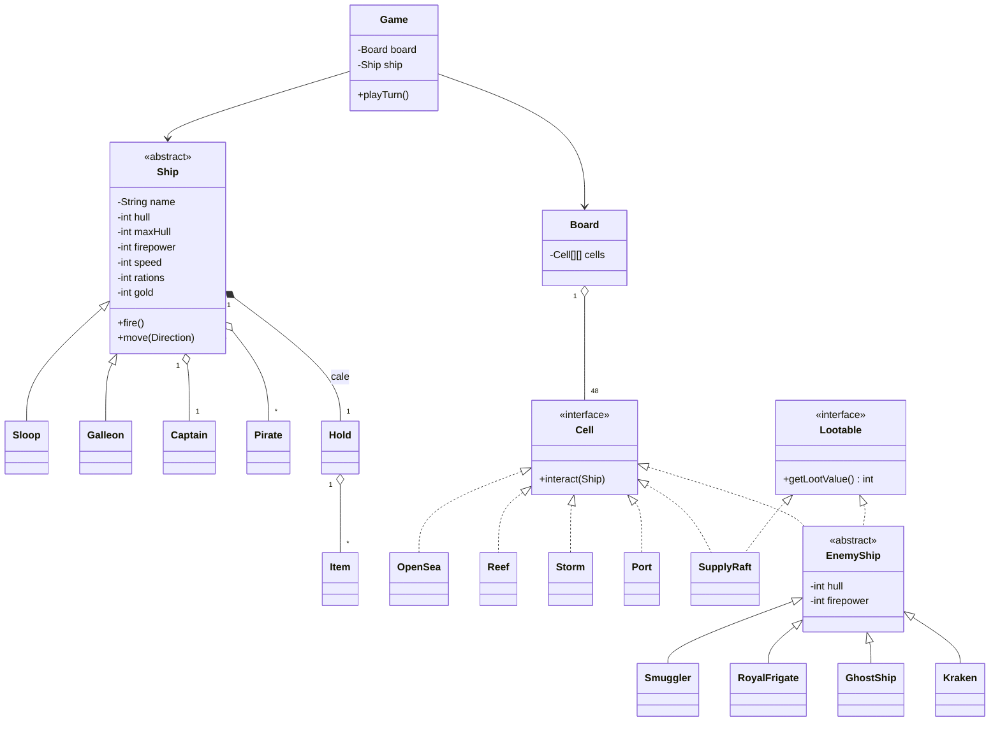

# Kit Java : « La Malédiction de l'île du Crâne »

Document de cadrage (titre de travail). Il fixe le concept, les règles du jeu, l'architecture cible et le découpage en itérations. Les chapitres du cours (fichiers `01` à `20`) sont rédigés ; les énoncés d'itérations seront rédigés ensuite, un par un, à partir de ce document. Dernière mise à jour : 19 novembre 2026 (numérotation des chapitres alignée sur les fichiers, tests et UML ajoutés).

## 1. Vision

### Objectif global

Apprendre Java en construisant un jeu d'aventure pirate en console, de la première ligne de code jusqu'à une application structurée qui sauvegarde ses parties dans une base SQL.

### Principes pédagogiques

- **Apprendre en faisant** : chaque itération livre un jeu un peu plus complet que la précédente.
- **Une seule trame, plusieurs durées** : les itérations 1 à 7 forment le parcours « découverte », les itérations 8 à 10 le parcours « avancé ».
- **Théorie intégrée** : chaque itération renvoie à des chapitres du cours (section « Boîte à outils ») et à la documentation officielle de Java. Aucune dépendance à un cours tiers.
- **Progression par paliers** : on teste d'abord sur une mini-carte avec un comportement prévisible, puis on passe à la carte complète et au hasard.
- **Réflexion avant la solution** : certaines étapes demandent de réfléchir quelques minutes avant de consulter la correction.
- **Anglais partout** : noms de classes, de méthodes, de variables et de packages.

### Public et durée indicative

Développeur débutant en Java, ayant déjà des bases d'algorithmique.

| Parcours | Itérations | Durée indicative |
|---|---|---|
| Découverte | 1 à 7 | 14 jours |
| Avancé | 8 à 10 | 5 jours |

### Compétences visées

- Manipuler l'environnement de développement (JDK, IDE, compilation, exécution)
- Programmer avec variables, conditions, boucles, tableaux et méthodes
- Déboguer un programme
- Définir des classes, instancier des objets, encapsuler
- Mettre en oeuvre l'héritage, les classes abstraites et les interfaces
- Gérer les exceptions
- Écrire des tests unitaires avec JUnit (facultatif)
- Manipuler les collections (`List`, `Set`, `Map`)
- Générer la Javadoc
- Modéliser avec UML (classes, cas d'utilisation, séquence)
- Accéder à une base SQL avec JDBC
- Appliquer des patrons de conception (Factory, Singleton, Builder) et des objets immuables
- Utiliser les expressions lambda, les Streams et `Optional`

## 2. L'univers

Le joueur incarne un capitaine qui quitte son port d'attache pour atteindre l'île du Crâne, au bout de la carte. Un monstre marin, le Kraken, garde le trésor. Il faut traverser des eaux dangereuses, croiser des navires ennemis, ravitailler son équipage et améliorer son bateau.

## 3. Règles du jeu (version de base)

### La carte

- Une grille de **6 lignes sur 8 colonnes** (48 cases), affichée en console.
- Le navire démarre en haut à gauche, dans un port. L'île du Crâne est en bas à droite.
- Chaque tour, le joueur choisit une direction (nord, sud, est, ouest) et avance d'**une case**. Sortir de la carte est interdit.

### Les cases

| Type de case | Effet à l'arrivée |
|---|---|
| Mer calme | Rien. |
| Récif | La coque perd 2 points. |
| Tempête | L'équipage perd 2 rations. |
| Port | Le joueur peut acheter des rations (1 pièce d'or chacune), réparer la coque (2 pièces par point) et recruter un pirate (5 pièces). |
| Radeau de ravitaillement | Contient un objet à ramasser (voir plus bas). |
| Navire ennemi | Un combat s'engage. |
| Île du Crâne | Combat final contre le Kraken. |

### Les navires du joueur

Au début de la partie, le joueur choisit son navire.

| | Sloop | Galleon |
|---|---|---|
| Coque maximale | 10 | 18 |
| Puissance de feu (base) | 3 | 5 |
| Vitesse (sert à fuir) | 4 | 2 |
| Cale (emplacements) | 2 | 4 |
| Rations au départ | 10 | 14 |
| Équipage maximal | 4 | 8 |
| Or au départ | 10 | 10 |

### Les rations

Chaque déplacement consomme 1 ration. Sans ration, chaque déplacement coûte 1 point de coque à la place (famine).

### L'équipage

Chaque pirate a un nom et un grade : mousse, matelot, canonnier ou quartier-maître. Chaque **canonnier** ajoute 1 à la puissance de feu, avec un maximum de +2. Les noms des pirates d'un même navire doivent être uniques.

### Les objets des radeaux

| Objet | Type | Effet |
|---|---|---|
| Rations | Consommable | +4 rations immédiatement. |
| Kit de réparation | Consommable | +3 points de coque immédiatement. |
| Canon long | Amélioration | +1 de puissance de feu, occupe un emplacement de cale. |
| Coque renforcée | Amélioration | +3 de coque maximale, occupe un emplacement de cale. |

Une amélioration n'est ramassée que s'il reste de la place dans la cale.

### Les combats

Le combat se joue au tour par tour. Le joueur tire toujours en premier. À chaque tour, il choisit :

- **Tirer** : les dégâts infligés valent `puissance de feu + dé à 6 faces - 4`, avec un minimum de 0. L'ennemi réplique ensuite avec la même formule appliquée à sa puissance de feu.
- **Fuir** : la fuite réussit si le dé à 6 faces donne un résultat inférieur ou égal à la vitesse du navire. Le navire revient alors à la case précédente. En cas d'échec, l'ennemi tire et le combat continue.

Les points de coque d'un ennemi sont conservés d'un tour à l'autre. Un ennemi vaincu disparaît de la carte et rapporte de l'or.

| Ennemi | Coque | Puissance de feu | Butin (or) |
|---|---|---|---|
| Contrebandier | 6 | 3 | 10 |
| Frégate royale | 12 | 5 | 25 |
| Vaisseau fantôme | 15 | 6 | 40 |
| Kraken (final) | 25 | 7 | 0 |

### Composition de la carte complète

| Élément | Nombre |
|---|---|
| Ports (dont celui de départ) | 3 |
| Île du Crâne | 1 |
| Récifs | 6 |
| Tempêtes | 4 |
| Radeaux de ravitaillement (3 rations, 2 kits, 2 canons longs, 1 coque renforcée) | 8 |
| Contrebandiers | 4 |
| Frégates royales | 3 |
| Vaisseau fantôme | 1 |
| Mer calme | 18 |

### Fin de partie

- **Victoire** : le Kraken est vaincu.
- **Défaite** : la coque tombe à 0 point.

Toutes ces valeurs sont un point de départ : l'apprenant est invité à les ajuster pour équilibrer le jeu.

## 4. Règles du jeu (version avancée)

Pistes à proposer en fin d'itération, au choix de l'apprenant :

- **Abordage** : quand la coque d'un ennemi est à moitié détruite, le joueur peut aborder. Un duel entre équipages se joue alors avec les grades des pirates.
- **Vent** : une direction de vent change chaque tour et modifie le coût en rations.
- **Brouillard** : les cases ne sont révélées que lorsqu'on est à côté.
- **Niveaux de difficulté** : nombre d'ennemis et de récifs paramétrable (se prête bien au patron Builder).
- **Plusieurs joueurs** en alternance sur la même carte.
- **Plusieurs chemins** avec des risques différents.
- **Tableau des scores** calculé à partir des parties sauvegardées.

## 5. Architecture cible

Package racine proposé : `com.pirates.adventure` (à remplacer par le domaine inversé de l'auteur). Les sous-packages sont tous en minuscules.

| Package | Contenu |
|---|---|
| `model.ship` | `Ship` (abstraite), `Sloop`, `Galleon`, `Captain`, `Pirate`, `Rank` (enum)  ; `ShipType` (enum) créé à l'itération 3, supprimé à l'itération 4 |
| `model.board` | `Board`, interface `Cell`, `OpenSea`, `Reef`, `Storm`, `Port`, `SupplyRaft`, `SkullIsland` |
| `model.enemy` | `EnemyShip` (abstraite), `Smuggler`, `RoyalFrigate`, `GhostShip`, `Kraken` |
| `model.item` | `Item` (abstraite), `Rations`, `RepairKit`, `LongCannon`, `ReinforcedHull`, interface `Lootable` ; `Hold<T extends Item>` (itération 9) |
| `engine` | `Game`, `Dice`, `Direction` (enum) |
| `ui` | `Menu` |
| `exception` | `OutOfMapException`, `NotEnoughGoldException`, `HoldFullException` |
| `db` | Accès à la base SQL |
| `util` | Utilitaires |

### Diagramme de classes

La cale (`Hold`) appartient au navire (composition : elle est créée avec lui). Les objets qu'elle contient existent avant d'être ramassés sur un radeau (agrégation). Jusqu'à l'itération 9, la cale est une simple `ArrayList<Item>` ; elle devient la classe générique `Hold<T extends Item>` à l'itération 9. Les notations sont expliquées dans l'annexe `20-uml.md`.

## 6. Gabarit d'une itération

Chaque énoncé suit la même structure :

1. **Modalités** : travail en autonomie, durée, production individuelle.
2. **Ce que le jeu sait faire à la fin** : un résultat visible, pour motiver.
3. **Compétences** et **chapitres du cours** à consulter (« Boîte à outils »), avec les liens vers la documentation officielle.
4. **Étapes numérotées** : « Étape 1 : ... », « Étape 2 : ... », chacune avec le fichier à modifier et l'endroit précis.
5. **Pause de réflexion** quand une décision de conception est à prendre, suivie de la solution.
6. **Conseils et contraintes** de développement.
7. **Pour aller plus loin** (facultatif).
8. **Livrables** : code poussé sur Git avec un commit par étape et une étiquette par itération, diagramme de classes à jour (annexe UML) et glossaire des syntaxes rencontrées.

### Contraintes pédagogiques récurrentes

- La méthode `main` reste courte (environ 15 lignes).
- `static` : aux itérations 1 et 2 (style procédural), les méthodes de `Main` sont `static`, car `main` l'est. À partir de l'itération 3 (objets), plus aucun `static` en dehors de `main` jusqu'à la classe utilitaire `Dice` (itération 6) : l'IDE le propose souvent comme correction, il faut d'abord comprendre pourquoi.
- Tous les attributs sont `private`.
- Chaque classe a ses accesseurs, un constructeur adapté et une méthode `toString`.
- Les commentaires Javadoc couvrent les classes et méthodes publiques.
- Relancer le programme après chaque changement de structure.

## 7. Découpage en itérations

### Correspondance des chapitres du cours

| N° | Fichier | Sujet |
|---|---|---|
| 1 | `01-premier-programme.md` | JDK, IntelliJ, Maven, compilation |
| 2 | `02-variables.md` | Variables |
| 3 | `03-operateurs.md` | Opérateurs |
| 4 | `04-structures-de-controle.md` | Conditions et boucles |
| 5 | `05-tableaux.md` | Tableaux |
| 6 | `06-methodes-et-debogage.md` | Méthodes, débogage |
| 7 | `07-classes-et-objets.md` | Classes et objets |
| 8 | `08-composition-packages-enum.md` | Composition, packages, enum |
| 9 | `09-heritage.md` | Héritage |
| 10 | `10-polymorphisme-et-object.md` | Polymorphisme, `Object`, `equals` / `hashCode` |
| 11 | `11-abstraction.md` | Classes abstraites, interfaces |
| 12 | `12-exceptions.md` | Exceptions |
| 13 | `13-patrons-generiques-collections.md` | Factory, Singleton, généricité, collections, XML |
| 14 | `14-immuabilite-dates-builder.md` | Immuabilité, dates, Builder |
| 15 | `15-tests-unitaires.md` | Tests unitaires avec JUnit (facultatif) |
| 16 | `16-classes-anonymes-et-lambdas.md` | Classes anonymes, lambdas |
| 17 | `17-streams.md` | Streams |
| 18 | `18-optional-et-references-de-methodes.md` | `Optional`, références de méthodes |
| 19 | `19-jdbc-et-sql.md` | JDBC et SQL (SQLite, variante MySQL) |
| 20 | `20-uml.md` | Annexe : UML |

`00-sommaire.md` (introduction et liens vers les chapitres) reste à écrire en dernier.

### Itération 1 : Prise en main (2 jours)

- **Résultat :** un programme qui calcule un chargement de bateau.
- **Contenu :** installer le JDK 21 et IntelliJ, créer un projet Maven, écrire un premier programme, le compiler et l'exécuter à la main (`javac`, `java`), puis dans l'IDE.
- **Exercice « Charger la chaloupe » :** 47 tonneaux de rhum à embarquer, 8 tonneaux par voyage.
  - Jour 1 : calculer avec `/` et `%` le nombre de voyages complets et le reste.
  - Jour 2 : avec une boucle et une condition, afficher « Voyage n : x tonneaux » pour chaque voyage, y compris le dernier incomplet.
- **Chapitres :** 1 à 4.

### Itération 2 : La carte au trésor (2 jours)

- **Résultat :** une carte affichée en console où un `N` se déplace jusqu'au `X`.
- **Contenu :** tableau à deux dimensions `char[][]` de 6 lignes sur 8 colonnes, affichage en grille, saisie de la direction avec `Scanner`, test des limites, boucle jusqu'à l'arrivée, découpage du code en méthodes `static` de `Main` (`createMap`, `printMap`, `isInsideMap`), utilisation du débogueur.
- **Pause de réflexion :** comment éviter de sortir de la carte ?
- **Chapitres :** 5 et 6 (les conditions et les boucles du chapitre 4 sont vues à l'itération 1).

### Itération 3 : Les premiers objets (2 jours)

- **Résultat :** un menu pour créer son capitaine et son navire, et un navire qui se déplace sur la carte.
- **Contenu :** classes `Ship`, `Captain`, `Menu` et `Game`, trois constructeurs, accesseurs, `toString`, packages, Javadoc.
- **Le type de navire, en deux temps (choix pédagogique assumé) :**
  - d'abord une `String` (`"sloop"` ou `"galleon"`) : l'apprenant rencontre lui-même le problème d'une valeur invalide qui compile (`"sloup"`) ;
  - **pause de réflexion** : comment empêcher une valeur invalide ? ;
  - puis refactorisation avec un enum `ShipType` (chapitre 8), qui porte aussi la coque maximale et la puissance de feu de base. Le compilateur signale tous les endroits à corriger.
- **Chapitres :** 7 et 8.

### Itération 4 : Héritage, abstraction et exceptions (2 jours)

- **Résultat :** les navires et les objets ont chacun leur classe.
- **Contenu :** `Ship` devient abstraite avec `Sloop` et `Galleon`, `Item` et ses quatre filles, enum `Rank`, `OutOfMapException` lancée et attrapée, visibilité `protected`.
- **Disparition de `ShipType` :** le type de navire est désormais porté par la classe elle-même, l'attribut et l'enum deviennent inutiles et sont supprimés. L'énoncé doit l'annoncer clairement : c'est l'aboutissement de la progression `String`, puis enum, puis héritage, et non un retour en arrière. Les `switch` sur le type, devenus lourds, justifient le polymorphisme, vu à l'itération 6 (chapitre 10). L'enum reste utile ailleurs (`Rank`, `Direction`).
- **Chapitres :** 9, 11 et 12.

### Itération 5 : La carte prend vie (2 jours)

- **Résultat :** une mini-carte 3 par 3 avec des cases qui réagissent au passage du navire.
- **Contenu :** interface `Cell`, tableau `Cell[][]`, `ArrayList` pour l'équipage et la cale, mini-carte fixe avec un dé qui renvoie toujours la même valeur, diagramme de classes (UML).
- **Pause de réflexion :** qu'est-ce qu'une case ? quelle relation entre un récif, un ennemi et la mer calme ? Ici la réponse est une interface.
- **Chapitres :** 11, 13 (section sur `ArrayList`) et 20 (annexe UML, pour le diagramme de classes).

### Itération 6 : Rencontres et combats (2 jours)

- **Résultat :** les rencontres fonctionnent et on peut se battre.
- **Contenu :**
  - première version avec `instanceof` et cast, puis refactorisation avec le polymorphisme (`interact` redéfinie dans chaque case), pour comprendre pourquoi la seconde solution est meilleure ;
  - classe utilitaire `Dice` (c'est ici que le `static` devient légitime) ;
  - combat au tour par tour avec « tirer » ou « fuir » ;
  - l'ennemi vaincu disparaît de la carte.
- **Chapitres :** 10 et 11.

### Itération 7 : La carte complète (2 jours)

- **Résultat :** la partie complète est jouable.
- **Contenu :** carte de 48 cases avec le nombre exact d'éléments prévu, puis placement aléatoire (mélange d'une liste), `equals` et `hashCode` sur `Pirate`, `Set` pour garantir des noms uniques, `Map` pour compter les objets, fin de partie.
- **Chapitres :** 10 (`equals`, `hashCode`, `Set`, `Map`) et 13.

### Itération 8 : Sauvegarde SQL (2 jours)

- **Résultat :** on peut sauvegarder et reprendre une partie.
- **Contenu :** conception du schéma (MCD puis MLD des tables de sauvegarde, avec renvoi vers le chapitre I de ton cours de bases de données), création du fichier SQLite et des tables, ajout de la dépendance `sqlite-jdbc` dans le `pom.xml` (première explication de Maven), classe d'accès dans le package `db`, `PRAGMA foreign_keys = ON` à chaque connexion, requêtes préparées, `try-with-resources`, transaction pour la sauvegarde complète, méthodes `saveGame`, `loadGames`, `updateHull`.
- **Pour aller plus loin :** variante MySQL (installation du serveur, driver `mysql-connector-j`, URL de connexion).
- **Chapitres :** 19 (JDBC et SQL), avec le cours de bases de données (I à III) en prérequis.

### Itération 9 : Architecture propre (2 jours)

- **Résultat :** le code est refactorisé avec des patrons de conception.
- **Contenu :** `ShipFactory` et `EnemyFactory`, singleton pour la configuration de la partie (avec ses limites), `GameOptions.Builder` pour la difficulté, objets immuables (`Treasure`, entrées du journal de bord avec `LocalDateTime`), cale générique `Hold<T extends Item>`.
- **Facultatif :** tests unitaires JUnit des classes de l'itération (`ShipFactory`, `equals` / `hashCode` de `Pirate`, copie défensive, Builder), présentés au chapitre 15.
- **Chapitres :** 13, 14 et 15 (facultatif).

### Itération 10 : Analyse de la flotte (1 jour)

- **Résultat :** un tableau des scores construit à partir de la base.
- **Contenu :** lambdas, Streams (`filter`, `map`, `sorted`, `limit`, `groupingBy`), `Optional`, références de méthodes.
- **Chapitres :** 16, 17 et 18.

### Annexes du kit

- Règles du jeu : version de base et version avancée (sections 3 et 4 de ce document).
- Cheat sheet de la POO, tiré de tes propres chapitres.
- Conception : diagramme de cas d'utilisation, de séquence et de classes (`20-uml.md`).

## 8. Écarts du cours : état

### Comblés

- **JDBC** : chapitre 19 écrit (connexion, `PreparedStatement`, `try-with-resources`, transactions, `PRAGMA foreign_keys`). Il s'appuie sur le cours de bases de données sans le répéter. Le code SQLite a été exécuté avec `sqlite-jdbc` 3.44.1.0 ; la variante MySQL n'a pas été testée.
- **Diagrammes UML** : annexe `20-uml.md` écrite (cas d'utilisation, séquence, classes). Distincts du MCD/MLD, qui décrit la base et non le programme.
- **Maven** : chapitre 1 adapté (projet Maven, sources dans `src/main/java`).
- **Tests unitaires** : chapitre 15 ajouté, facultatif, placé après l'immuabilité et le Builder.
- **`Set`, `Map`, types enveloppes, portée des variables, évaluation courte de `&&` et `||`** : présents dans les chapitres 3, 4, 6, 10 et 13.

### Restant

- **Corrections à apporter au cours de bases de données** : clés étrangères non appliquées par défaut dans SQLite, `AUTOINCREMENT` facultatif, types SQLite non imposés, `CREATE DATABASE` / `USE` inexistants dans SQLite.
- **Schémas de base de données** : MCD/MLD théoriques dans le chapitre I ; les deux fichiers draw.io (Twitter, stations-service) sont des travaux de débutant, à refaire proprement pour le kit (notation Merise : entités en rectangles, associations en rectangles arrondis, cardinalités `0,n` / `1,1` sur les liens).
- **Sommaire** : `00-sommaire.md` à écrire en dernier.
- **Énoncés des itérations** : à rédiger, en commençant par l'itération 1 (« Charger la chaloupe »).
- **Versions** : à vérifier sur Maven Central (décisions 2 et 6 ci-dessous).

## 9. Décisions encore ouvertes

1. **Moteur de base de données** : décidé, SQLite pour le kit, MySQL en « pour aller plus loin ».
2. **Gestion des dépendances** : décidé (délégué par Romain), Maven dès l'itération 1, expliqué seulement à l'itération 8. Versions écrites dans les chapitres : `sqlite-jdbc` 3.53.2.1 (chapitre 19, non vérifiée sur Maven Central ; le code a été testé avec 3.44.1.0).
3. **Nom du kit** : « La Malédiction de l'île du Crâne » est un titre de travail.
4. **Valeurs de jeu** : à tester en conditions réelles avant de les figer.
5. **Type de navire** : décidé, `String` puis enum `ShipType` à l'itération 3, puis suppression au profit de l'héritage à l'itération 4. Risque identifié : trois versions du même concept peuvent frustrer l'apprenant, d'où l'importance de l'annoncer dans l'énoncé.
6. **Tests unitaires** : décidé, JUnit 6 seul (pas de Mockito), facultatif, chapitre 15, à partir de l'itération 9. Dépendance `org.junit.jupiter:junit-jupiter` en version 6.1.3 (dernière version lue dans les notes de version, à vérifier sur Maven Central) ; Java 17 minimum ; `maven-surefire-plugin` 3.0.0 ou plus. Les annotations et assertions utilisées ne figurent pas parmi les changements de la version 6 selon la documentation, mais les tests du chapitre n'ont été exécutés qu'avec JUnit 5.10.1 : à lancer avec la version 6 en construisant le projet du kit.
7. **JDK** : 21 pour le kit (compatible avec JUnit 6, qui demande Java 17 minimum).
